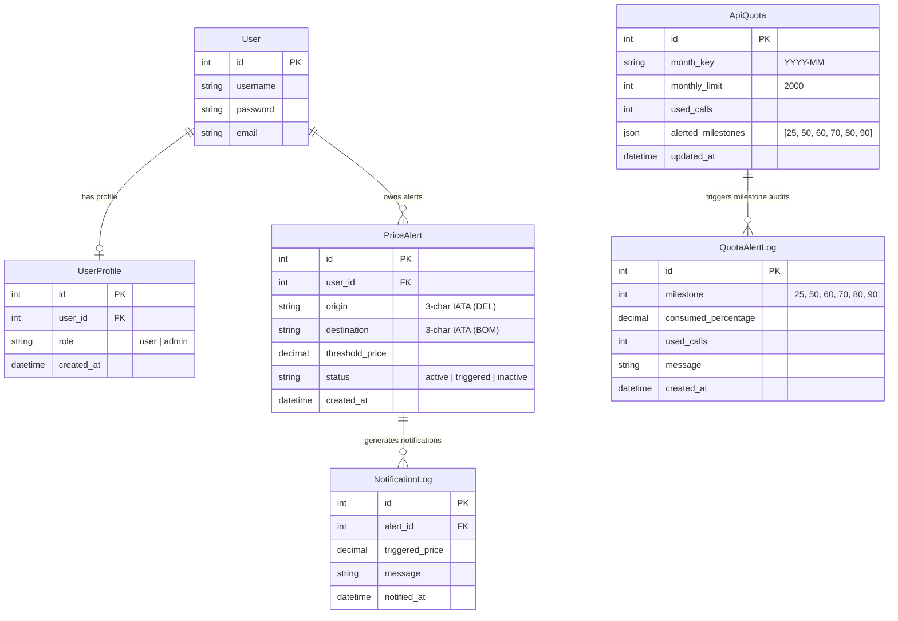
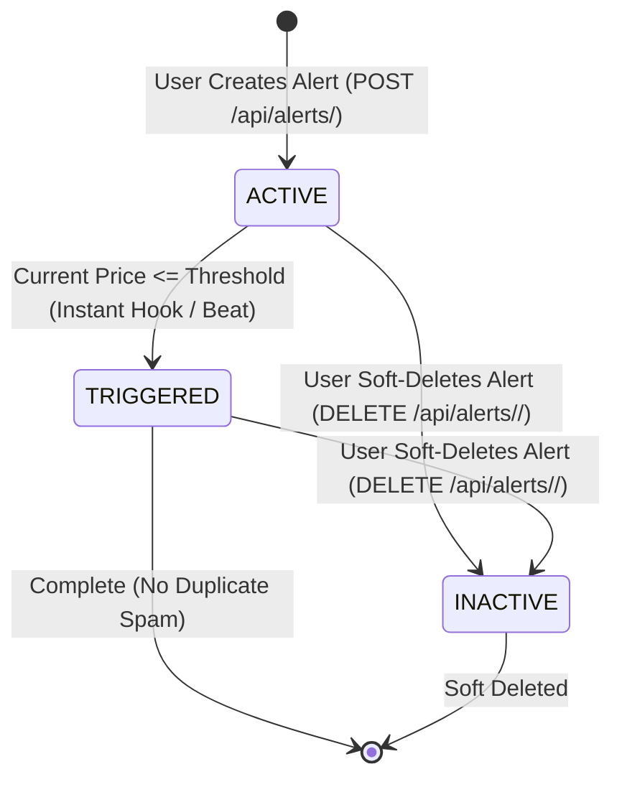

# PulseNotify — Full-Stack Technical Architecture, Testing Manual & System Architecture Guide
## Master Engineering Reference for Real-Time Flight Price Monitoring & Telemetry

---

## 0. PulseNotify in Plain English (Layman & Executive Perspective)

> **Explain Like I'm 5 (ELI5)**: You want to travel from Delhi to Mumbai, but only if the flight is under ₹4,000. Airline tickets fluctuate dozens of times a day. You cannot sit in front of a computer 24/7 refreshing ticket websites. PulseNotify is your **tireless, 24/7 personal travel butler** that monitors fares every 30 seconds and notifies you the exact millisecond the price drops.

### The 30-Second Metaphor: "The Personal Flight Butler"

| Phase | Butler Action | System Reality |
| :--- | :--- | :--- |
| **1. Set Target** | You tell the butler: *"Notify me if DEL-BOM drops below ₹4,000."* | Creates a row in PostgreSQL with `status="active"`. Takes 5ms. |
| **2. Auto-Scan (30s)** | Butler checks the airport departure screen every 30s (or when you tap 'Scan Now'). | Celery Beat scheduler ticks every 30.0s; on-demand scan bypasses cache with `?refresh=true`. |
| **3. Instant Catch (0ms)** | Fare drops to ₹3,800. Butler spots it instantly without waiting. | Synchronous ingestion hook `evaluate_alerts_for_price()` triggers notifications in 0ms. |
| **4. Zero Spam Guard** | Butler taps your shoulder once with your ₹200 savings, then stays quiet. | State machine flips alert to `TRIGGERED`. No repeated notification spam every 30 seconds. |

### Plain English $\leftrightarrow$ Under-the-Hood Technology Translation Matrix

| Plain English Concept | Engineering Implementation | How It Works in Layman Terms |
| :--- | :--- | :--- |
| **The Autonomous Alarm Clock** | **Celery Beat (30s Cycle)** | Wakes up quietly every 30.0 seconds to run flight scans even if your laptop is closed. |
| **The Lightning Messenger** | **Redis 7 Broker & Cache** | Holds background jobs and stores 30s price snapshots so the UI and background workers always agree. |
| **The Dedicated Worker** | **Celery Worker Pool** (`--pool=solo`) | Handles database writes and notification tasks in the background so the web app never freezes. |
| **The Unbreakable Safe** | **PostgreSQL 17 Database** | Stores accounts, alerts, and audit logs. Deactivating an alert keeps historical logs forever. |
| **The Fuel Gauge** | **Quota Milestone Trapping** | Warns administrators at 25%, 50%, 60%, 70%, 80%, and 90% usage so API credits never run out. |
| **The Private Compartment** | **Row-Level JWT Isolation** | Guarantees User A can never see User B's alerts. Guessing another user's alert ID returns a blank 404. |
| **The Smart Bundler** | **$O(N) \to O(1)$ Route Batching** | If 1,000 travelers monitor DEL-BOM, PulseNotify calls the airline once, not 1,000 times. |

---

## 1. Executive Summary & Architecture Pitch

### 1.1 The Problem Statement
Airlines utilize dynamic pricing models that fluctuate dozens of times daily based on seat inventories, demand spikes, and departure countdowns. Travelers looking for budget-friendly fares cannot manually monitor ticket portals 24/7. When prices momentarily drop during off-peak hours, the window closes before users notice.

### 1.2 The PulseNotify Solution
**PulseNotify** is a production-grade, distributed event-driven monitoring system designed to mirror the core engines of **Google Flights**, **Skyscanner**, and **Hopper**:
- **Instant Response**: Users submit flight price threshold alerts (e.g., *"Notify me when DEL to BOM drops below ₹4,500"*) via a sub-second REST API without waiting for synchronous provider calls.
- **Instant Event-Driven & 30s Polling**: Alerts evaluate instantly upon price ingestion with zero delay. In addition, Celery Beat wakes up on a synchronized 30-second periodic schedule for autonomous background monitoring.
- **Shared Redis Price Snapshot (Single Source of Truth)**: A 30-second Redis cache ensures the frontend Flight Radar and Celery worker always evaluate the exact same ticket prices.
- **On-Demand "Scan Now" Force-Refresh**: Passing `?refresh=true` invalidates/bypasses the 30s Redis cache on-demand, fetching fresh fluctuating fares immediately and evaluating matching alerts.
- **Multi-Alert Route Tagging & Tiered Triggering**: Multiple alerts on the same route display aggregated badges (`🔔 2 Alerts Active: ≤₹4,000, ≤₹3,500`). When fares drop below both thresholds, each triggers independently with separate audit logs and savings calculations.
- **Route Aggregation Optimization**: Rather than querying airlines $N$ times for $N$ users, the engine aggregates distinct routes into a single batch query ($O(N) \to O(1)$ API calls per route), saving bandwidth and protecting third-party rate quotas.
- **Idempotent Asynchronous Dispatch**: When prices drop below a threshold, a worker dispatches a notification task, records an immutable audit log, and transitions the alert status from `ACTIVE` to `TRIGGERED` to prevent duplicate notification spam.
- **Enterprise Security & Quota Telemetry**: Multi-tenant row-level scoping guarantees users only ever access their own monitors, while administrators gain real-time analytics and third-party API quota tracking (milestone traps at 25%, 50%, 60%, 70%, 80%, and 90%).

---

## 2. Full-Stack System Architecture

```mermaid
flowchart TD
    subgraph ClientLayer ["1. Client & Presentation Layer (React 18 + Vite SPA)"]
        RadarUI["Flight Radar View\n(30s Auto-Poll & Live Tags)"]
        AlertsUI["Price Alerts Manager\n(CRUD & Auto-Refresh)"]
        NotifsUI["Notification Center\n(Savings Audit Log)"]
        AdminUI["Admin Analytics\n(RBAC Telemetry)"]
        SimUI["Simulator View\n(Deterministic Testing)"]
    end

    subgraph ProxyLayer ["2. Reverse Proxy Layer"]
        ViteProxy["Vite Dev Server (:5173)\nProxy: /api/* -> 127.0.0.1:8000\n(Eliminates CORS)"]
    end

    subgraph APILayer ["3. Application Gateway (Django REST Framework 3.18)"]
        AuthModule["/api/auth/*\n(SimpleJWT & Signal Hook)"]
        AlertsModule["/api/alerts/*\n(User Scoped QuerySets)"]
        FlightModule["/api/flights/price/\n(Instant Alert Evaluator & Cache)"]
        AdminModule["/api/admin/*\n(IsAdminUser Guard & Quota)"]
    end

    subgraph AsyncQueue ["4. Asynchronous Queue & Event Processing (Redis 7 + Celery)"]
        CeleryBeat["Celery Beat Scheduler\n(Periodic Fallback: 30s)"]
        RedisBroker["Redis 7 Broker & Cache\n(Port 6379, DB 0, 30s TTL Snapshot)"]
        CeleryWorker["Celery Worker Pool\n(--pool=solo on Windows)"]
        InstantHook["Instant Evaluator Hook\n(evaluate_alerts_for_price: 0ms)"]
        CheckPricesTask["pulse.tasks.check_prices\n(Periodic Route Aggregator)"]
        SendNotifTask["pulse.tasks.send_notification\n(Audit Logger & State Flip)"]
    end

    subgraph Persistence ["5. Relational Persistence Layer (PostgreSQL 17)"]
        DBUser["auth_user & pulse_userprofile"]
        DBAlert["pulse_pricealert\n(Status: active, triggered, inactive)"]
        DBNotif["pulse_notificationlog\n(Immutable Audit Trail)"]
        DBQuota["pulse_apiquota & pulse_quotaalertlog\n(Milestone History)"]
    end

    ClientLayer --> ProxyLayer
    ProxyLayer --> APILayer
    APILayer --> Persistence
    FlightModule -->|1. Reads/Sets 30s Price Snapshot| RedisBroker
    FlightModule -->|2. Instant Cross-Check: 0ms| InstantHook
    InstantHook -->|Threshold Met| SendNotifTask
    CeleryBeat -->|Enqueues Task (every 30s)| RedisBroker
    RedisBroker -->|Pulls Task| CeleryWorker
    CeleryWorker --> CheckPricesTask
    CheckPricesTask -->|Queries Cached Snapshot| RedisBroker
    CheckPricesTask -->|Threshold Met| SendNotifTask
    SendNotifTask -->|Updates Status & Logs| DBAlert
    SendNotifTask --> DBNotif
```

---

## 3. Entity Relationships, Instantaneous Evaluation & Step-by-Step Module Cross-Checking

### 3.1 Domain Entity Relationships (ERD)



### 3.2 Alert Lifecycle State Machine



### 3.3 Dual-Trigger Evaluation Architecture

The alert evaluation engine uses a high-performance **dual-trigger topology**:

1. **Trigger Path A: Instant Event-Driven Ingestion Hook (0ms Latency)**
   - When any traveler, administrator, or UI client queries `GET /api/flights/price/?route={ROUTE}`, `evaluate_alerts_for_price()` is executed immediately on the ingested fare.
   - Matching active alerts are identified synchronously and queued to `send_notification.delay()`. The client receives the `triggered_alerts` list directly in the HTTP 200 payload.

2. **Trigger Path B: Celery Beat 30-Second Periodic Fallback**
   - Configured in `CELERY_BEAT_SCHEDULE` with interval `30.0` seconds (`check-flight-prices-every-30-seconds`).
   - Dispatches `pulse.tasks.check_prices` into Redis 7 to aggregate all active routes and evaluate thresholds even if no users are actively browsing the site.

3. **Redis 7 Shared Route Snapshot Cache (`TTL=30s`)**
   - Route prices are cached under key `pulsenotify:flight_price:{ROUTE}` with a 30-second TTL.
   - Guarantees a single source of truth across both Path A (instant user queries) and Path B (Celery Beat periodic ticks), completely eliminating race conditions.

4. **On-Demand "Scan Now" Force-Refresh (`force_refresh=True` / `?refresh=true`)**
   - When the traveler clicks "Scan Now" in Flight Radar or the 30-second countdown reaches zero, the client passes `?refresh=true`.
   - `CachedFlightProvider` invalidates/bypasses the 30s Redis cache, calculates a fresh fluctuating price immediately, updates Redis with a fresh 30s TTL, and triggers instant alert cross-checking.

### 3.3.1 Tiered Multi-Alert Trigger Mechanics (Same Route Scenarios)

When multiple alerts are configured for the exact same route (e.g., Alert 1 with threshold $\le ₹4,000$ and Alert 2 with threshold $\le ₹3,500$ on `DEL-BOM`):
- **Flight Radar Tagging**: Displays an aggregated badge (`🔔 2 Alerts Active`) alongside individual threshold chips (`≤₹4,000`, `≤₹3,500`).
- **Fluctuation to ₹3,800**:
  - Alert 1 ($\le ₹4,000$) satisfies threshold: triggers, records ₹200 savings, transitions to `TRIGGERED`.
  - Alert 2 ($\le ₹3,500$) does not satisfy threshold: remains `ACTIVE`.
- **Fluctuation to ₹3,200**:
  - Both Alert 1 ($\le ₹4,000$) and Alert 2 ($\le ₹3,500$) satisfy the threshold simultaneously.
  - `evaluate_alerts_for_price()` iterates through **all** matching active alerts and dispatches separate Celery tasks: `send_notification.delay(alert_1.id, 3200)` and `send_notification.delay(alert_2.id, 3200)`.
  - The Celery worker records two distinct `NotificationLog` entries (Alert 1 logs ₹800 savings; Alert 2 logs ₹300 savings).
  - Both alerts transition to `TRIGGERED` atomically, preventing duplicate alerts on future 30-second polling cycles.

---

### 3.4 Step-by-Step Module Cross-Checking Guide (Pointwise & Concise)

The following 10 core modules define the system's operational lifecycle:

#### 3.4.1 Module 1: Flight Pricing, 30s Redis Cache & On-Demand Refresh
- **Primary Component:** `pulse/views.py` (`FlightPriceView`), `pulse/services/flight_provider.py` (`CachedFlightProvider`).
- **Operational Objective:** Serve real-time route prices while caching snapshots in Redis for 30s, with on-demand cache invalidation via `?refresh=true`.
- **Cross-Checking Steps:**
  1. Call `GET /api/flights/price/?route=DEL-BOM`. Verify HTTP 200 response with `price`, `airline`, `provider`, and `quota`.
  2. Call the identical route again within 30 seconds. Verify the price remains identical (served from Redis key `pulsenotify:flight_price:DEL-BOM`).
  3. Call `GET /api/flights/price/?route=DEL-BOM&refresh=true`. Verify cache is bypassed and fresh fluctuating fare is returned.
  4. Verify Flight Radar card displays updated fare, route tag, and active countdown timer.

#### 3.4.2 Module 2: SimpleJWT Authentication & Auto-Profile Hook
- **Primary Component:** `pulse/views.py` (`RegisterView`, `LoginView`), Django signals (`post_save`).
- **Operational Objective:** Stateless JWT token issuance with 7-day validity and automatic role provisioning.
- **Cross-Checking Steps:**
  1. Call `POST /api/auth/register/` with `username` and `password`. Verify HTTP 201 Created and receipt of JWT `access` token.
  2. Check `pulse_userprofile` table to confirm a linked profile row is automatically created with `role='user'`.
  3. Call `POST /api/auth/login/` with correct credentials -> HTTP 200 OK; invalid credentials return HTTP 401 Unauthorized.

#### 3.4.3 Module 3: Price Alert Lifecycle & Idempotency Engine
- **Primary Component:** `pulse/views.py` (`PriceAlertListCreateView`), `pulse/models.py` (`PriceAlert`).
- **Operational Objective:** User-scoped alert creation with atomic state management (`ACTIVE` -> `TRIGGERED` -> `INACTIVE`).
- **Cross-Checking Steps:**
  1. Call `POST /api/alerts/` with `origin="DEL"`, `destination="BOM"`, `threshold_price=4500`. Verify HTTP 201 Created.
  2. Verify alert starts with `status="active"` and is bound to the requesting user via foreign key.
  3. Confirm frontend sidebar alert badge increments by 1; Flight Radar card shows green active tracker tag.

#### 3.4.4 Module 4: Instantaneous Ingestion & Cross-Checking Engine
- **Primary Component:** `pulse/tasks.py` (`evaluate_alerts_for_price`), `FlightPriceView.get()`.
- **Operational Objective:** 0-millisecond alert evaluation executed synchronously upon price discovery.
- **Cross-Checking Steps:**
  1. Create an alert whose threshold is greater than or equal to the current route price (e.g. price ₹4,150, threshold ₹4,500).
  2. Ingest the price via `GET /api/flights/price/?route=DEL-BOM`.
  3. Check response payload: verify `triggered_alerts` contains the alert ID; alert transitions to `TRIGGERED` in 0ms.

#### 3.4.5 Module 5: Celery Beat 30-Second Background Scheduler
- **Primary Component:** `config/settings/base.py` (`CELERY_BEAT_SCHEDULE`), Celery Beat process.
- **Operational Objective:** Autonomous background polling clock executing every 30.0s.
- **Cross-Checking Steps:**
  1. Observe Celery Beat console logs. Confirm tick fires every 30.0s: `Scheduler: Sending due task check-flight-prices-every-30-seconds`.
  2. Verify task is enqueued to Redis broker (key `celery`).
  3. Confirms alerts are evaluated in background even when no active users are interacting with the web application.

#### 3.4.6 Module 6: Celery Worker Async Execution & Solo Pool
- **Primary Component:** `pulse/tasks.py` (`check_prices`, `send_notification`), Celery Worker process (`--pool=solo`).
- **Operational Objective:** Asynchronous task processing offloading heavy writes and notification dispatch.
- **Cross-Checking Steps:**
  1. Observe Celery Worker terminal. Verify startup parameters specify `--pool=solo` for Windows compatibility.
  2. Verify worker receives task: `[Received task: pulse.tasks.send_notification]`.
  3. Worker completes execution: `[Task send_notification succeeded in 0.03s]`.

#### 3.4.7 Module 7: Notification Center & Savings Audit Trail
- **Primary Component:** `pulse/views.py` (`NotificationListView`), `pulse/models.py` (`NotificationLog`).
- **Operational Objective:** Immutable notification audit log tracking price drops and total savings.
- **Cross-Checking Steps:**
  1. Call `GET /api/notifications/` with user JWT. Verify HTTP 200 OK.
  2. Inspect response array: verify presence of `triggered_price`, savings calculation, and timestamp.
  3. Verify frontend sidebar notification counter updates in real time and renders an in-app toast banner.

#### 3.4.8 Module 8: Soft Delete & State Machine Protection
- **Primary Component:** `pulse/views.py` (`PriceAlertDetailView`).
- **Operational Objective:** Preserve foreign key references in notification logs while stopping duplicate alerts.
- **Cross-Checking Steps:**
  1. Call `DELETE /api/alerts/<id>/` for an active or triggered alert. Verify HTTP 200 OK.
  2. Verify database record is preserved with `status="inactive"`.
  3. Filter alerts on frontend: inactive tab displays de-activated monitors; active tab excludes them.

#### 3.4.9 Module 9: Multi-Tenant Isolation & 404 Cloaking
- **Primary Component:** `pulse/views.py` (`get_queryset`, `get_object_or_404`), Django ORM user scoping.
- **Operational Objective:** Complete row-level tenant security preventing ID enumeration.
- **Cross-Checking Steps:**
  1. User A creates Alert #1.
  2. User B authenticates with a separate token and calls `GET /api/alerts/1/`.
  3. API responds with HTTP 404 Not Found (cloaking record existence) rather than HTTP 403 Forbidden.

#### 3.4.10 Module 10: Admin RBAC Telemetry & Third-Party API Quota Trapping
- **Primary Component:** `pulse/views.py` (`AdminSummaryView`, `ApiQuotaView`), `pulse/services/quota_tracker.py`.
- **Operational Objective:** Admin-only system telemetry and early-warning rate-limit threshold alerts.
- **Cross-Checking Steps:**
  1. Call `GET /api/admin/summary/` as regular user -> HTTP 403 Forbidden. Call as admin -> HTTP 200 OK with system statistics.
  2. Call `POST /api/admin/quota/simulate/` with `target_percentage=50` -> verify milestone alert log created and yellow warning banner renders.
  3. Call `POST /api/admin/quota/` (reset) -> clears counter to 0 calls and dismisses quota warning banner.

---

## 4. The 4 Engineering Pillars for Distributed Architecture

### Pillar 1: High-Efficiency Route Aggregation ($O(N) \to O(1)$)
- **Problem**: If 1,000 users configure alerts for `DEL-BOM`, querying external providers 1,000 times per minute would breach API rate limits and incur massive financial costs.
- **Solution**: PulseNotify's Celery task executes:
  ```python
  active_alerts = PriceAlert.objects.filter(status=PriceAlert.Status.ACTIVE)
  routes = active_alerts.values_list('origin', 'destination').distinct()
  ```
  It queries the flight price feed **exactly once per unique route**, then iterates through all subscribed alerts in-memory.

### Pillar 2: Idempotent Notification Dispatch
- **Problem**: If a flight stays cheap for 3 hours, a naive monitoring system would send 180 duplicate notifications to the user.
- **Solution**: Once `send_notification` executes, the alert status atomically transitions to `TRIGGERED`:
  ```python
  alert.status = PriceAlert.Status.TRIGGERED
  alert.save()
  ```
  Future polling cycles filter for `status='active'`, completely isolating triggered monitors and preventing spam.

### Pillar 3: Multi-Tenant Data Isolation
- **Problem**: Data leakage where User A can inspect or tamper with User B's alerts.
- **Solution**: Every query in `PriceAlertListCreateView` and `PriceAlertDetailView` enforces ownership at the ORM level:
  ```python
  PriceAlert.objects.filter(user=self.request.user)
  ```
  If a user attempts to access an alert belonging to another account, Django returns `404 Not Found` rather than `403`, preventing ID enumeration.

### Pillar 4: Third-Party API Quota Milestone Trapping
- Tracks monthly consumption against provider constraints (e.g., Amadeus 2,000 free monthly calls).
- State-machine triggers milestone logs at exact thresholds: **25%, 50%, 60%, 70%, 80%, and 90%**.
- Dispatches alert events to the frontend Quota Banner in real-time, giving administrators runway to upgrade tiers before service degradation occurs.

---

## 5. Local Setup: 5 Terminal Execution

To validate the application locally, start the 5 services:

```powershell
# TERMINAL 1: Infrastructure (Docker)
docker compose up -d

# TERMINAL 2: Django API Server
.\venv\Scripts\Activate.ps1
python manage.py runserver

# TERMINAL 3: Celery Worker (Windows solo pool)
.\venv\Scripts\Activate.ps1
celery -A config worker --loglevel=info --pool=solo

# TERMINAL 4: Celery Beat Scheduler
.\venv\Scripts\Activate.ps1
celery -A config beat --loglevel=info

# TERMINAL 5: Frontend Vite Application
cd frontend
npm run dev
```

---

## 6. Comprehensive 10-Step Local Functional Validation Manual

| Step | User Action in Browser | Expected UI Result | Backend Trace & Terminal Logs |
| :--- | :--- | :--- | :--- |
| **1. Radar Telemetry** | Visit `http://localhost:5173/`, stay on **Flight Radar** tab | 4 route cards (`DEL-BOM`, `BLR-HYD`, `DEL-BLR`, `BOM-GOA`) display live ₹ prices, carrier names, flight numbers, and a 30s auto-refresh ring. | Terminal 2 shows `GET /api/flights/price/?route=... 200 OK`. |
| **2. Auth & JWT** | Click **Sign In / Register** -> **Register**. Enter `traveler_john` / `TravelPass@123`. | Modal closes, green toast notification appears. Navbar displays `traveler_john` with blue `USER` badge. | Network tab shows `POST /api/auth/register/ 201 Created`. LocalStorage holds `pulsenotify_token`. |
| **3. Fast Route Pre-fill** | On **Flight Radar**, click **Track This Route** on `DEL → BOM`. | Automatically routes to **Price Alerts** tab. Modal opens pre-filled with `DEL`, `BOM`, and current price. | React cross-tab state passing verified. |
| **4. Create Price Alert** | Set Target Price to `4500` and click **Activate Alert**. | Modal closes. Alert appears with emerald `ACTIVE` badge. Sidebar count increments to `1`. | `POST /api/alerts/ 201 Created`. Row added to `pulse_pricealert`. |
| **5. Status Filters & Soft Delete** | Create 2nd alert (`BLR-HYD`). Click trash can icon on it to deactivate. | Alert flips to gray `INACTIVE` badge. Filter by `Active` hides it; filter by `Inactive` displays it. | `DELETE /api/alerts/<id>/ 200 OK`. Soft delete in database confirmed. |
| **6. Background Trigger** | Go to **Simulator** tab. Select `DEL-BOM`, click **Scan Current Price**, then **Evaluate Alerts Against Price**. | Live log shows `✓ HIT: Alert #1 threshold satisfied!`. In **Price Alerts**, badge flips to violet `TRIGGERED`. | Celery worker terminal logs `send_notification received` & `succeeded`. |
| **7. Notification Center** | Click **Notifications** in left sidebar. | Audit card displays price drop event, saving amount, date/time, and link to `Alert #1`. | `GET /api/notifications/ 200 OK`. Record fetched from `pulse_notificationlog`. |
| **8. Multi-Tenant Check** | Sign out. Register `traveler_sarah`. | Empty state: Sarah sees 0 alerts and 0 notifications. | Row-level scoping confirmed. Direct ID access returns 404. |
| **9. Admin RBAC** | View **Admin Analytics** -> Blocked. Promote via terminal: `python manage.py shell -c "..."`. Relogin. | Lock opens. View system-wide stats: Total alerts, active vs. triggered monitors, Top Routes leaderboard. | `GET /api/admin/summary/ 200 OK` protected by `IsAdminUser`. |
| **10. Quota Simulation** | In **Simulator**, advance quota to `25%`, `50%`, `80%`. | Milestone toasts fire. Yellow **Quota Alert Banner** appears at top of screen. Admin audit log records triggers. | `POST /api/admin/quota/simulate/ 200 OK`. Reset button clears counter to 0. |

---

## 7. System Architecture FAQ & Engineering Tradeoffs

### Q1: "Why use Celery Beat instead of standard Linux cron or in-memory Python timers?"
> **Model Answer**: "In-memory timers like `time.sleep()` inside web threads block server capacity and die immediately if the process restarts. Linux cron jobs lack centralized task queues, retry logic, and monitoring. Celery Beat acts as a dedicated clock process that publishes task messages to Redis. This decouples scheduling from execution: worker nodes can scale horizontally, recover gracefully from restarts, and handle load bursts without dropping events."

### Q2: "How do you protect third-party airline APIs from rate limits and quota depletion?"
> **Model Answer**: "We implement two distinct protective layers: First, **Route Aggregation**: when evaluating prices, Celery aggregates distinct routes via SQL `.distinct()`, reducing $N$ user monitors to 1 external API call per route. Second, **Telemetry & Milestone Trapping**: we track monthly API calls in PostgreSQL and evaluate threshold traps at 25%, 50%, 60%, 70%, 80%, and 90%. When a milestone is breached, system administrators receive real-time alerts on the dashboard before limits are exceeded."

### Q3: "How do you prevent a user from getting spammed with 100 notifications if a flight remains below their threshold?"
> **Model Answer**: "We built an explicit state machine for alerts: `ACTIVE`, `TRIGGERED`, and `INACTIVE`. When the background worker detects a price drop, it invokes `send_notification`, which atomically transitions the alert from `ACTIVE` to `TRIGGERED`. Future polling tasks filter exclusively on `status='active'`, ensuring an alert only triggers once per configuration."

### Q4: "Why choose PostgreSQL over a NoSQL database for this system?"
> **Model Answer**: "Flight price alerts require strict relational integrity and transactional guarantees. The foreign key relationship between Users, Alerts, and NotificationLogs must maintain ACID compliance. Furthermore, soft-deletes and aggregated queries (such as grouping distinct routes and calculating top-monitored destinations) leverage PostgreSQL's query optimizer efficiently."

### Q5: "If a user has two alerts on DEL-BOM (one for ≤₹4,000 and one for ≤₹3,500) and the price drops to ₹3,200, what happens?"
> **Model Answer**: "Both alerts trigger independently. The evaluation engine identifies all active alerts whose threshold is greater than or equal to ₹3,200. Because both ₹4,000 and ₹3,500 satisfy the condition, the system enqueues two separate `send_notification.delay(alert_id, price)` Celery tasks. Each task generates its own `NotificationLog` entry with individual savings calculations (₹800 savings for the ₹4,000 alert and ₹300 savings for the ₹3,500 alert) and transitions each alert atomically to `TRIGGERED`. On subsequent 30-second cycles, neither alert triggers again due to anti-spam idempotency."

### Q6: "Why specify --pool=solo for Celery workers on Windows?"
> **Model Answer**: "Windows does not support the POSIX `fork()` system call, which is Celery's default execution mechanism on Linux. Running Celery without `--pool=solo` on Windows causes multiprocessing deadlocks, task hanging, and file descriptor permission errors. The solo pool executes tasks in-process within a single thread, providing complete reliability during local development while maintaining full Redis queue semantics."


