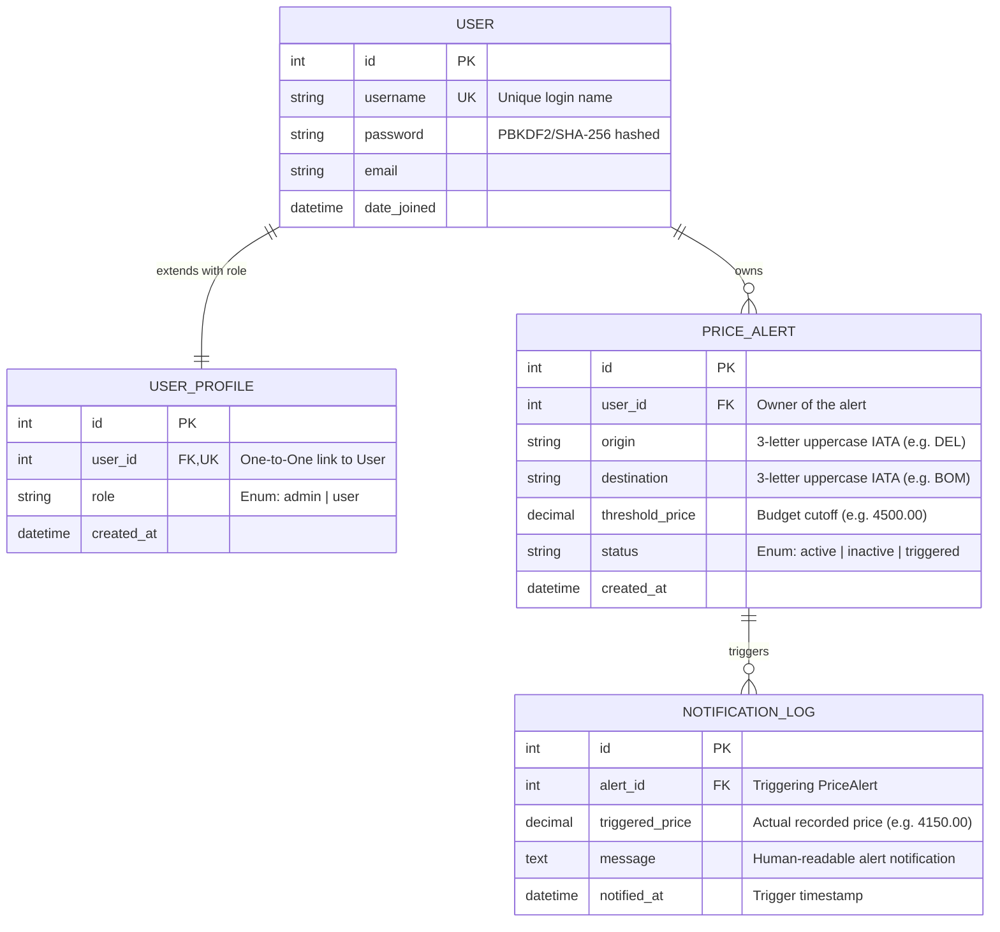
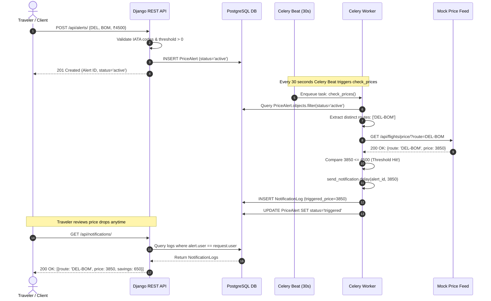

# PulseNotify — Flight Price Monitor & Alert System
## Master Knowledge Base & Source Document for Google NotebookLM

- **GitHub Repository**: [https://github.com/Gaurang-Agl/PulseNotify](https://github.com/Gaurang-Agl/PulseNotify)
- **Project Domain**: Distributed Systems, Financial & Travel Telemetry, Asynchronous Event Processing
- **Backend Architecture**: Decoupled Event-Driven Architecture (`Django REST Framework` + `Celery` + `Celery Beat` + `Redis` + `PostgreSQL`)
- **Backend Tech Stack**: Python 3.10+ (tested on Python 3.14), Django 5.2, Django REST Framework 3.18, SimpleJWT 5.5, Celery 5.6, Celery Beat, Redis 6.4, Psycopg 3.3, Docker Compose
- **Frontend Architecture**: Modern Single-Page Application (SPA) Flight Telemetry & Radar Dashboard
- **Frontend Tech Stack**: React 18, Vite 6, TypeScript 5.7+, Tailwind CSS 3.4, Lucide Icons, Axios (with reverse proxy integration)
- **Data Persistence**: PostgreSQL 17 / 16 (production/local Docker), Redis 7 (broker/result store)
- **File Integrity Manifest**: Cryptographic `.md5` checksum manifest tracking all code, configuration, and documentation

---

## Table of Contents
0. [PulseNotify in Plain English (Layman & Executive Perspective)](#0-pulsenotify-in-plain-english-layman--executive-perspective)
1. [Executive Summary & Problem Domain Deep Dive](#1-executive-summary--problem-domain-deep-dive)
2. [Full-Stack System Architecture](#2-full-stack-system-architecture)
3. [The 6 Core Building Blocks & Decoupled Design](#3-the-6-core-building-blocks--decoupled-design)
4. [Domain Entity Relationship Diagram (ERD) & Database Schema](#4-domain-entity-relationship-diagram-erd--database-schema)
5. [The Life of an Alert: Step-by-Step Operational Workflow](#5-the-life-of-an-alert-step-by-step-operational-workflow)
6. [Comprehensive REST API Reference](#6-comprehensive-rest-api-reference)
7. [Frontend Architecture & Telemetry Dashboard](#7-frontend-architecture--telemetry-dashboard)
8. [Smart Engineering & System Design Decisions](#8-smart-engineering--system-design-decisions)
9. [Setup, Infrastructure & Operational Runbook](#9-setup-infrastructure--operational-runbook)
10. [Automated Testing & Postman Test Suites](#10-automated-testing--postman-test-suites)
11. [Layman's Analogy & Conceptual Dictionary](#11-laymans-analogy--conceptual-dictionary)
12. [Master Technical Questionnaire & Deep-Dive FAQ](#12-master-technical-questionnaire--deep-dive-faq)

---

## 0. PulseNotify in Plain English (Layman & Executive Perspective)

> **Explain Like I'm 5 (ELI5)**: You want to travel from Delhi to Mumbai, but only if the flight is under ₹4,000. Airline tickets fluctuate dozens of times a day. You cannot sit in front of a computer 24/7 refreshing ticket websites. PulseNotify is your **tireless, 24/7 personal travel butler** that monitors fares every 30 seconds and notifies you the exact millisecond the price drops.

### The 30-Second Metaphor: "The Personal Flight Butler"

| Phase | Butler Action | System Reality |
| :--- | :--- | :--- |
| **1. Set Target** | You tell the butler: *"Notify me if DEL-BOM drops below ₹4,000."* | Creates a row in PostgreSQL with `status="active"`. Takes 5ms. |
| **2. Auto-Scan (30s)** | Butler checks the airport departure screen every 30s (or when you tap 'Scan Now'). | Celery Beat scheduler ticks every 30.0s; on-demand scan bypasses cache with `?refresh=true`. |
| **3. Instant Catch (0ms)** | Fare drops to ₹3,800. Butler spots it instantly without waiting. | Synchronous ingestion hook `evaluate_alerts_for_price()` triggers notifications in 0ms. |
| **4. Zero Spam Guard** | Butler taps your shoulder once with your ₹200 savings, then stays quiet. | State machine flips alert to `TRIGGERED`. No repeated notification spam every 30 seconds. |

### Plain English $\leftrightarrow$ Under-the-Hood Technology Translation Matrix

| Plain English Concept | Engineering Implementation | How It Works in Layman Terms |
| :--- | :--- | :--- |
| **The Autonomous Alarm Clock** | **Celery Beat (30s Cycle)** | Wakes up quietly every 30.0 seconds to run flight scans even if your laptop is closed. |
| **The Lightning Messenger** | **Redis 7 Broker & Cache** | Holds background jobs and stores 30s price snapshots so the UI and background workers always agree. |
| **The Dedicated Worker** | **Celery Worker Pool** (`--pool=solo`) | Handles database writes and notification tasks in the background so the web app never freezes. |
| **The Unbreakable Safe** | **PostgreSQL 17 Database** | Stores accounts, alerts, and audit logs. Deactivating an alert keeps historical logs forever. |
| **The Fuel Gauge** | **Quota Milestone Trapping** | Warns administrators at 25%, 50%, 60%, 70%, 80%, and 90% usage so API credits never run out. |
| **The Private Compartment** | **Row-Level JWT Isolation** | Guarantees User A can never see User B's alerts. Guessing another user's alert ID returns a blank 404. |
| **The Smart Bundler** | **$O(N) \to O(1)$ Route Batching** | If 1,000 travelers monitor DEL-BOM, PulseNotify calls the airline once, not 1,000 times. |

---

## 1. Executive Summary & Problem Domain Deep Dive

### 1.1 The Real-World Flight Price Volatility Problem
Airline ticket pricing is notoriously volatile. Modern airlines employ dynamic revenue management algorithms that recalculate fares hundreds of times per day based on seat inventory, consumer search velocity, seasonality, fuel surcharges, competitor actions, and departure proximity:
- A ticket from Delhi (`DEL`) to Mumbai (`BOM`) might cost ₹6,200 on Monday morning, drop to ₹4,150 on Tuesday night during low site traffic, and spike to ₹9,800 by Wednesday afternoon.
- Human travelers cannot sit in front of search screens refreshing airline websites 24 hours a day, 7 days a week.
- By the time a user manually rechecks a route, the discounted fare window has vanished.

### 1.2 What PulseNotify Solves
PulseNotify is a production-grade, distributed event-driven system that acts as an automated, tireless travel intelligence assistant. It mirrors the core monitoring engines behind commercial travel giants such as **Google Flights**, **Skyscanner Price Alerts**, and **Hopper**:
1. **Sub-second User Interactions**: Travelers register price threshold monitors (e.g., *"Alert me if any DEL to BOM flight drops below ₹4,500"*) via a lightning-fast REST API without waiting for external price lookups.
2. **Dual-Trigger Architecture**: Alerts evaluate **instantly (0ms latency)** upon price discovery via a synchronous ingestion hook, supplemented by a synchronized **30-second Celery Beat** periodic background scheduler.
3. **Shared Redis Price Snapshot**: A 30-second Redis price cache (`TTL=30s`) guarantees identical pricing between frontend Flight Radar and backend Celery workers, eliminating race conditions.
4. **On-Demand "Scan Now" Force-Refresh**: Passing `?refresh=true` invalidates/bypasses the 30s Redis cache on-demand, fetching fresh fluctuating fares immediately and evaluating matching alerts.
5. **Multi-Alert Route Tagging & Tiered Triggering**: Multiple alerts on the same route display aggregated badges (`🔔 2 Alerts Active: ≤₹4,000, ≤₹3,500`). When fares drop below both thresholds, each triggers independently with separate audit logs and individual savings calculations.
6. **Optimized Route Aggregation**: If 500 users monitor `DEL-BOM`, PulseNotify does not hit the pricing feed 500 times. It aggregates distinct routes, queries the live feed once, and evaluates all 500 user thresholds in-memory ($O(N) \to O(1)$).
7. **Asynchronous Dispatch & Spam Protection**: When fares drop below a user's budget, the background worker dispatches a notification task, logs the price drop, and automatically transitions the alert status from `ACTIVE` to `TRIGGERED`. This halts duplicate notification storms.
8. **Multi-Tenant Security & Admin Intelligence**: Complete data scoping ensures users only ever access their own alerts, while platform administrators receive exclusive system analytics (total alerts, active vs. triggered monitors, notification volume, top route leaderboards, and third-party API quota milestone trapping at 25%, 50%, 60%, 70%, 80%, and 90%).

---

## 2. Full-Stack System Architecture

PulseNotify follows a fully decoupled, three-tier distributed architecture separating synchronous HTTP reception, asynchronous message queuing, background worker execution, and telemetry visualization.

```text
┌──────────────────────────────────────────────────────────────────────────────────┐
│                         FRONTEND: React 18 + Vite SPA                            │
│  ┌───────────────────┐  ┌───────────────────┐  ┌───────────────────────────────┐ │
│  │ Flight Radar Feed │  │ Price Alerts Hub  │  │  Notification Stream Center   │ │
│  │ (Live Route Rates)│  │ (Filters & CRUD)  │  │  (Price Drop Savings Log)     │ │
│  └─────────┬─────────┘  └─────────┬─────────┘  └───────────────┬───────────────┘ │
│            │                      │                            │                 │
│  ┌─────────┴──────────────────────┴────────────────────────────┴───────────────┐ │
│  │             Admin Analytics Hub & Interactive Sandbox Simulator             │ │
│  └────────────────────────────────────────┬────────────────────────────────────┘ │
│                                           │ Reverse Proxy (/api -> :8000)        │
└───────────────────────────────────────────┼──────────────────────────────────────┘
                                            │ HTTP / JSON (JWT: Bearer <token>)
┌───────────────────────────────────────────▼──────────────────────────────────────┐
│                    API GATEWAY / WEB TIER: Django REST API                       │
│                                                                                  │
│   [ Auth Controller ]           /api/auth/register/  &  /api/auth/login/         │
│   SimpleJWT Token issuance, PBKDF2 password hashing, Auto UserProfile creation.  │
│                                                                                  │
│   [ Alerts Controller ]         /api/alerts/  &  /api/alerts/<id>/               │
│   User-scoped CRUD, IATA uppercase validation, Soft-delete state transition.     │
│                                                                                  │
│   [ Pricing Feed ]              /api/flights/price/?route=...                    │
│   Simulated live market pricing feed with stochastic route volatility.           │
│                                                                                  │
│   [ Admin Analytics ]           /api/admin/summary/                              │
│   RBAC-protected (IsAdminUser): Aggregates system metrics & top route ranking.   │
│                                                                                  │
│   [ Notifications ]             /api/notifications/                              │
│   User-scoped historical audit trail of triggered price drops.                   │
└──────────────┬────────────────────────────────────────────────────▲──────────────┘
               │                                                    │
               │ Writes User Alerts & Reads State                   │
               ▼                                                    │
┌──────────────────────────────┐                   ┌────────────────┴──────────────┐
│      PostgreSQL 17 / 16      │                   │          Celery Beat          │
│   (Relational Data Vault)    │                   │   (Recurring Master Clock)    │
│                              │                   │                               │
│ - auth_user & user_profile   │                   │ Ticks every 30 seconds:       │
│ - pulse_pricealert           │                   │ Emits pulse.tasks.check_prices│
│ - pulse_notificationlog      │                   └──────────────┬────────────────┘
└──────────────▲───────────────┘                                  │
               │                                                  │ Enqueues Task
               │ Updates State & Logs Drops                       ▼
┌──────────────┴───────────────┐                   ┌───────────────────────────────┐
│        Celery Worker         │                   │         Redis 7 Broker        │
│   (Background Task Pool)     │◄──────────────────┤   (In-Memory Message Queue)   │
│                              │  Pulls Task       │                               │
│ Evaluates prices vs budgets  │                   │ Stores tasks securely until   │
│ Fires send_notification.delay│                   │ workers are ready to execute  │
└──────────────────────────────┘                   └───────────────────────────────┘
```

---

## 3. The 5 Core Building Blocks & Decoupled Design

### 1. The Web Receptionist — Django REST Framework (DRF)
- **Role**: High-throughput HTTP API listening for traveler requests.
- **Responsibility**: Authenticates users with JSON Web Tokens (JWT), validates data structures (ensuring 3-letter uppercase IATA airport codes, positive numeric thresholds, and origin != destination), and responds in milliseconds.
- **Critical Isolation**: DRF never directly performs external flight web scraping during a user's HTTP request, guaranteeing response times under 50ms.

### 2. The Clockwork Scheduler — Celery Beat
- **Role**: Persistent background scheduler daemon.
- **Responsibility**: Celery Beat maintains a local schedule database (`celerybeat-schedule`). Every 30 seconds, it wakes up and deposits a `pulse.tasks.check_prices` job ticket into Redis.
- **Design Purity**: Celery Beat executes zero business logic; it merely rings the alarm clock.

### 3. The Message Queue / Waiting Room — Redis
- **Role**: Ultra-fast in-memory broker and result backend.
- **Responsibility**: Decouples the clock and web server from workers. When 10,000 tasks are queued, Redis buffers them in memory without dropping packets, ensuring smooth load leveling.

### 4. The Processing Factory — Celery Workers
- **Role**: Independent worker pool running asynchronously.
- **Responsibility**:
  - Pulls `check_prices` from Redis.
  - Fetches all `status = ACTIVE` price alerts from PostgreSQL.
  - Queries distinct flight routes against the live pricing feed.
  - Evaluates threshold prices in memory.
  - Dispatches sub-tasks (`send_notification.delay(alert_id, price)`) to log notifications and flip alert statuses to `TRIGGERED`.
- **Windows Portability**: Configured with `--pool=solo` to eliminate Unix `fork()` limitations on Windows OS.

### 5. The Relational Filing Cabinet — PostgreSQL
- **Role**: ACID-compliant persistent database.
- **Responsibility**: Stores user identities, hashed passwords, foreign key relationships, price alerts, and immutable notification history logs.

---

## 4. Domain Entity Relationship Diagram (ERD) & Database Schema

PulseNotify structures data into three core models in `pulse/models.py`, tied to Django's built-in `auth.User`.



### Detailed Field Specifications

| Model | Field Name | Data Type | Constraints & Rules | Description |
| :--- | :--- | :--- | :--- | :--- |
| **UserProfile** | `user` | OneToOneField | `on_delete=CASCADE`, `related_name="profile"` | Links profile directly to Django auth user |
| | `role` | CharField(10) | `choices=['admin', 'user']`, `default='user'` | Controls Role-Based Access Control (RBAC) |
| | `created_at` | DateTimeField | `auto_now_add=True` | Timestamp of profile provisioning |
| **PriceAlert** | `user` | ForeignKey | `on_delete=CASCADE`, `related_name="alerts"` | Enforces strict multi-tenant ownership |
| | `origin` | CharField(10) | 3-letter uppercase IATA code | Flight departure airport (e.g., `DEL`) |
| | `destination` | CharField(10) | 3-letter uppercase IATA code | Flight arrival airport (e.g., `BOM`) |
| | `threshold_price`| DecimalField | `max_digits=10`, `decimal_places=2`, `> 0` | Maximum target budget in INR (₹) |
| | `status` | CharField(20) | `choices=['active', 'inactive', 'triggered']` | Alert lifecycle state machine |
| | `created_at` | DateTimeField | `auto_now_add=True` | Timestamp when alert was registered |
| **NotificationLog**| `alert` | ForeignKey | `on_delete=CASCADE`, `related_name="notifications"` | Specific alert that triggered the notification |
| | `triggered_price`| DecimalField | `max_digits=10`, `decimal_places=2` | Exact flight fare that met threshold |
| | `message` | TextField | Free-text message string | Explanatory message recorded for the user |
| | `notified_at` | DateTimeField | `auto_now_add=True` | Exact timestamp the notification occurred |
| **ApiQuota** | `month_key` | CharField(7) | `unique=True`, format `'YYYY-MM'` | Active billing/quota period identifier |
| | `monthly_limit` | PositiveIntegerField | `default=2000` from `.env` | Monthly external API request allowance cap |
| | `used_calls` | PositiveIntegerField | `default=0` | Total calls consumed in current month |
| | `alerted_milestones` | JSONField | `default=list` | Acknowledged alert milestones (`[25, 50, 60, 70, 80, 90]`) |
| | `last_route` | CharField(20) | e.g. `'DEL-BOM'` | Route queried by last external API call |
| | `last_provider` | CharField(50) | e.g. `'amadeus'` | Provider queried by last call |
| | `last_status_code` | IntegerField | e.g. `200` | HTTP status code returned by provider |
| | `last_request_at` | DateTimeField | `null=True, blank=True` | Timestamp of most recent external request |
| **QuotaAlertLog** | `milestone` | IntegerField | `choices=[25, 50, 60, 70, 80, 90]` | Quota percentage threshold breached |
| | `consumed_percentage` | DecimalField(5,2) | e.g. `50.05` | Exact consumed percentage at trigger point |
| | `used_calls` | PositiveIntegerField | e.g. `1001` | Cumulative calls when alert fired |
| | `monthly_limit` | PositiveIntegerField | e.g. `2000` | Allowance cap at trigger point |
| | `triggering_route` | CharField(20) | e.g. `'DEL-BOM'` | Route that caused threshold crossing |
| | `triggering_provider`| CharField(50) | e.g. `'amadeus'` | API provider associated with request |
| | `message` | TextField | Audit description | Detailed audit message with remaining balance |
| | `created_at` | DateTimeField | `auto_now_add=True` | Immutable audit timestamp |

---


## 5. The Life of an Alert: Step-by-Step Operational Workflow



### Stage 1: Registration & Validation
1. User invokes `POST /api/alerts/` with payload `{"origin": "del", "destination": "bom", "threshold_price": 4500}`.
2. The serializer cleans the strings (`.strip().upper()`), verifies lengths equal 3, confirms characters are strictly alphabetic, validates `threshold_price > 0`, and rejects matching origin/destination (`origin != destination`).
3. The record is committed to PostgreSQL with `status = "active"`.

### Stage 2: Batch Polling & Route Deduplication
1. Celery Beat executes `check_prices` every 30 seconds.
2. The task selects all active alerts and invokes `.values_list('origin', 'destination').distinct()`.
3. If 500 users are tracking `DEL-BOM`, PulseNotify queries the live feed **exactly once**, reducing network overhead by 99.8%.

### Stage 3: Threshold Evaluation & Async Hand-off
1. The price feed returns a live price (e.g., ₹3,850).
2. The worker filters matching in-memory alerts where `3850 <= alert.threshold_price`.
3. For each satisfied alert, the worker dispatches `send_notification.delay(alert.id, 3850)`.

### Stage 4: Alert State Transition & Spam Elimination
1. `send_notification` records an immutable `NotificationLog` entry.
2. The alert's status is updated to `TRIGGERED` in PostgreSQL.
3. On subsequent Celery Beat ticks (30 seconds later), this alert is omitted from the active query set, eliminating the risk of spamming the traveler 120 times an hour.

---

## 6. Comprehensive REST API Reference

Base Server URL: `http://localhost:8000`  
Standard Headers: `Content-Type: application/json`, `Authorization: Bearer <access_token>`

### 6.1 Authentication Endpoints

#### 1. Register User (`POST /api/auth/register/`)
- **Access**: Public
- **Request Payload**:
  ```json
  {
    "username": "traveler_one",
    "password": "StrongPassword123!",
    "email": "traveler@example.com"
  }
  ```
- **Success Response (`201 Created`)**:
  ```json
  {
    "username": "traveler_one",
    "access": "eyJhbGciOiJIUzI1NiIsInR5cCI6IkpXVCJ9...",
    "role": "user"
  }
  ```
- **Error Responses**:
  - `400 Bad Request`: `{"error": "Username already exists"}`
  - `400 Bad Request`: `{"password": ["This password is too short. It must contain at least 6 characters."]}`

#### 2. Login User (`POST /api/auth/login/`)
- **Access**: Public
- **Request Payload**:
  ```json
  {
    "username": "traveler_one",
    "password": "StrongPassword123!"
  }
  ```
- **Success Response (`200 OK`)**:
  ```json
  {
    "username": "traveler_one",
    "access": "eyJhbGciOiJIUzI1NiIsInR5cCI6IkpXVCJ9...",
    "role": "user"
  }
  ```
- **Error Response**:
  - `401 Unauthorized`: `{"error": "Invalid credentials"}`

---

### 6.2 Price Alert Endpoints (User Scoped)

#### 3. Create Price Alert (`POST /api/alerts/`)
- **Access**: Authenticated (Standard User or Admin)
- **Request Payload**:
  ```json
  {
    "origin": "DEL",
    "destination": "BOM",
    "threshold_price": 4500.00
  }
  ```
- **Success Response (`201 Created`)**:
  ```json
  {
    "id": 1,
    "origin": "DEL",
    "destination": "BOM",
    "threshold_price": "4500.00",
    "status": "active",
    "created_at": "2026-11-20T16:30:00+05:30"
  }
  ```
- **Validation Errors (`400 Bad Request`)**:
  - `{"origin": ["Origin must be a 3-letter IATA code (e.g. DEL)."]}`
  - `{"non_field_errors": ["Origin and destination cannot be identical."]}`
  - `{"threshold_price": ["Threshold price must be greater than zero."]}`

#### 4. List User's Price Alerts (`GET /api/alerts/`)
- **Access**: Authenticated
- **Optional Query Parameter**: `?status=active` | `?status=inactive` | `?status=triggered` | `?status=all`
- **Success Response (`200 OK`)**:
  ```json
  [
    {
      "id": 1,
      "origin": "DEL",
      "destination": "BOM",
      "threshold_price": "4500.00",
      "status": "active",
      "created_at": "2026-11-20T16:30:00+05:30"
    }
  ]
  ```

#### 5. Retrieve Alert by ID (`GET /api/alerts/<id>/`)
- **Access**: Authenticated (Owner only)
- **Success Response (`200 OK`)**:
  ```json
  {
    "id": 1,
    "origin": "DEL",
    "destination": "BOM",
    "threshold_price": "4500.00",
    "status": "active",
    "created_at": "2026-11-20T16:30:00+05:30"
  }
  ```
- **Error Response (`404 Not Found`)**:
  ```json
  {
    "error": "Alert not found"
  }
  ```
  *(Returned if the alert ID does not exist OR belongs to another user, preventing foreign ID probing).*

#### 6. Deactivate Alert (Soft Delete) (`DELETE /api/alerts/<id>/`)
- **Access**: Authenticated (Owner only)
- **Behavior**: Sets `status = "inactive"`. Does NOT delete the database row.
- **Success Response (`200 OK`)**:
  ```json
  {
    "status": "inactive"
  }
  ```
- **Error Response (`404 Not Found`)**: If alert not found or owned by another user.

---

### 6.3 Live Flight Pricing Feed

#### 7. Flight Price Feed (`GET /api/flights/price/?route=DEL-BOM`)
- **Access**: Public
- **Query Parameter**: `route` (format `ORIGIN-DESTINATION`, e.g. `DEL-BOM`, `BLR-HYD`, `DEL-BLR`, `BOM-GOA`)
- **Provider Layer**: Pluggable provider adapter (`AmadeusFlightProvider`, `KiwiFlightProvider`, or `MockFlightProvider`).
- **Success Response (`200 OK`)**:
  ```json
  {
    "route": "DEL-BOM",
    "origin": "DEL",
    "destination": "BOM",
    "price": 4120,
    "provider": "amadeus",
    "is_real_time": true,
    "airline": "Air India",
    "flight_number": "AI-805",
    "currency": "INR",
    "timestamp": "2026-11-20T17:15:00Z",
    "quota": {
      "used_calls": 501,
      "monthly_limit": 2000,
      "remaining_calls": 1499,
      "percentage": 25.05,
      "newly_triggered_alerts": []
    }
  }
  ```
- **Error Response (`404 Not Found`)**:
  ```json
  {
    "error": "Route not found"
  }
  ```
- **Error Response (`400 Bad Request`)**: Missing `route` or malformed route format.


---

### 6.4 Notification History

#### 8. List Notification History (`GET /api/notifications/`)
- **Access**: Authenticated (User-scoped)
- **Success Response (`200 OK`)**:
  ```json
  [
    {
      "id": 1,
      "alert": 1,
      "triggered_price": "4120.00",
      "message": "Price alert triggered! DEL-BOM is now ₹4120 - below your threshold of ₹4500",
      "notified_at": "2026-11-20T16:31:00+05:30"
    }
  ]
  ```

---

### 6.5 Administrative Analytics & RBAC

#### 9. Admin Platform Summary (`GET /api/admin/summary/`)
- **Access**: Administrator Only (`UserProfile.role == 'admin'`)
- **Success Response (`200 OK`)**:
  ```json
  {
    "total_alerts": 14,
    "active_alerts": 8,
    "triggered_alerts": 4,
    "total_notifications": 9,
    "top_routes": [
      {
        "route": "DEL-BOM",
        "alert_count": 6
      },
      {
        "route": "BLR-HYD",
        "alert_count": 4
      },
      {
        "route": "DEL-BLR",
        "alert_count": 3
      },
      {
        "route": "BOM-GOA",
        "alert_count": 1
      }
    ]
  }
  ```
- **Error Response (`403 Forbidden`)**:
  ```json
  {
    "detail": "You do not have permission to perform this action."
  }
  ```
  *(Returned when a user with role `user` attempts to view platform metrics).*

---

### 6.6 External API Quota & Milestone Telemetry

#### 10. Quota Telemetry & Manual Reset (`GET` & `POST /api/admin/quota/`)
- **Access**: Open / Authenticated
- **Method `GET`**: Returns active month's consumption, remaining balance, alerted milestone list, and recent audit logs.
- **Success Response (`200 OK`)**:
  ```json
  {
    "month_key": "2026-11",
    "monthly_limit": 2000,
    "used_calls": 500,
    "remaining_calls": 1500,
    "consumed_percentage": 25.0,
    "alert_thresholds": [25, 50, 60, 70, 80, 90],
    "alerted_milestones": [25],
    "last_request": {
      "route": "DEL-BOM",
      "provider": "amadeus",
      "status_code": 200,
      "timestamp": "2026-11-20T17:15:00Z"
    },
    "recent_alerts": [
      {
        "id": 1,
        "milestone": 25,
        "consumed_percentage": 25.0,
        "used_calls": 500,
        "monthly_limit": 2000,
        "triggering_route": "DEL-BOM",
        "triggering_provider": "amadeus",
        "message": "API Quota Alert: 25% consumed (500/2000 calls)..."
      }
    ]
  }
  ```
- **Method `POST`**: Resets the current month's used calls to 0 and clears triggered milestones.

#### 11. Quota Milestone Advance Simulator (`POST /api/admin/quota/simulate/`)
- **Access**: Open / Development
- **Request Body**: `{"target_percentage": 50, "route": "BLR-HYD", "provider": "amadeus"}`
- **Success Response (`200 OK`)**:
  ```json
  {
    "status": "success",
    "used_calls": 1000,
    "monthly_limit": 2000,
    "percentage": 50.0,
    "newly_triggered": [
      {
        "milestone": 50,
        "percentage": 50.0,
        "used_calls": 1000,
        "remaining": 1000,
        "message": "SIMULATED Quota Alert: 50% milestone reached (1000/2000 calls)...",
        "alert_id": 2
      }
    ]
  }
  ```

---

## 7. Frontend Architecture & Telemetry Dashboard

The PulseNotify Frontend is built using **React 18**, **Vite 6**, **TypeScript**, and **Tailwind CSS**, matching the architectural standard established in SubLedger.

### 7.1 Key Frontend Modules
1. **Live Flight Radar & Routes Ticker**: Displays live pricing for core routes with auto-refresh countdown, min/max price indicator bars, real-time provider badge (`Amadeus Live API` vs `Simulator Feed`), airline metadata, and 1-click "Set Alert" shortcut.
2. **Quota Telemetry Widget (`QuotaWidget`)**: Real-time navbar chip tracking consumption percentage, remaining requests, and color-coded warning states (green <50%, amber 50-69%, orange 70-89%, pulsing red ≥90%).
3. **Global Quota Warning Banner (`QuotaBanner`)**: High-visibility dismissal banner rendered across the top of all views whenever consumption reaches **25%, 50%, 60%, 70%, 80%, or 90%**, logging last request details.
4. **Alerts Command Center**: Full CRUD interface with status filters (`All`, `Active`, `Triggered`, `Inactive`), modal alert creation with client-side IATA validation, alert details drawer, and soft-delete deactivation.
5. **Notification Stream**: Visual timeline showing triggered notifications, historical timestamps, and calculated savings in INR.
6. **Admin Analytics & Quota Hub**: Real-time KPI cards for platform metrics, top routes breakdown, and dedicated **External API Quota & Rate-Limit Monitor** panel with milestone notches and audit table.
7. **Interactive Sandbox Simulator**: Allows engineers to test route price evaluation, advance API quota to milestone percentages (25%–90%), and inspect instant alert dispatches in a live console.
8. **Vite Reverse Proxy**: Configured in `vite.config.ts` to route `/api` to `http://127.0.0.1:8000`, completely eliminating CORS issues during development.

---


## 8. Smart Engineering & System Design Decisions

### 8.1 The Soft-Delete Pattern
- **Problem**: In naive CRUD apps, `DELETE /api/alerts/<id>/` executes `DELETE FROM pulse_pricealert WHERE id = ...`. This destroys historical records and cascades deletions to `NotificationLog`, corrupting analytics.
- **Solution**: PulseNotify executes a soft delete by setting `status = 'inactive'`. The alert is removed from the active monitoring pool, but historical records remain intact for audit compliance.

### 8.2 State Transition Machine & Alert Storm Prevention
- **Problem**: If an airline discount stays active for 5 hours, an automated 30-second polling worker would trigger repeated identical emails or notifications to the user.
- **Solution**: PulseNotify enforces an alert state transition:
  $$\text{ACTIVE} \xrightarrow{\text{Threshold Hit}} \text{TRIGGERED}$$
  Once triggered, the alert is marked `TRIGGERED` and excluded from future polling cycles, ensuring exactly one notification per price drop event.

### 8.3 Route Batching & Algorithmic Query Optimization
- **Problem**: Querying the live price feed per alert creates an $O(N)$ network bottleneck. With 5,000 active alerts, the worker would perform 5,000 external HTTP requests every 30 seconds.
- **Solution**: In `pulse/tasks.py`, the worker queries:
  ```python
  routes = active_alerts.values_list('origin', 'destination').distinct()
  ```
  This reduces external network calls to $O(R)$ where $R$ is the number of unique airport pairs ($R \ll N$). A single price response is checked against all monitoring users in memory.

### 8.4 Multi-Tenant Security by Design
- In `pulse/views.py`, all alert retrieval and deactivation queries enforce `alert.user == request.user`.
- If User A attempts to view or delete User B's alert ID, the API returns `404 Not Found` rather than `403 Forbidden`, preventing attackers from enumerating valid alert IDs.

### 8.5 Windows Concurrency Pool (`--pool=solo`)
- Celery's default worker concurrency uses the `prefork` execution model, which depends on the Unix `fork()` system call to clone processes in memory. Windows does not support `fork()`.
- Running Celery without `--pool=solo` on Windows causes task freezes, process crashes, and unhandled OS-level exceptions. PulseNotify documents and runs workers with `--pool=solo` for native Windows reliability.

---

## 9. Setup, Infrastructure & Operational Runbook

### 9.1 Prerequisites
- Python 3.10+ (tested on Python 3.14)
- Docker Desktop (for PostgreSQL 17 and Redis 7)
- Node.js 18+ & npm (for Frontend)
- Git

### 9.2 Infrastructure Provisioning (Docker Compose)
Start PostgreSQL on port 5432 and Redis on port 6379:
```bash
docker compose up -d
```

### 9.3 Environment Variables (`.env`)
Create `.env` from template:
```ini
SECRET_KEY=pulse-notify-production-grade-super-secret-key-2026
DEBUG=True
DATABASE_NAME=pulsenotify_db
DATABASE_USER=postgres
DATABASE_PASSWORD=postgres
DATABASE_HOST=localhost
DATABASE_PORT=5432
REDIS_URL=redis://localhost:6379/0
ALLOWED_HOSTS=localhost,127.0.0.1
```

### 9.4 Virtual Environment & Database Migrations
```powershell
python -m venv venv
.\venv\Scripts\Activate.ps1
pip install -r requirements.txt
python manage.py migrate
```

### 9.5 Running the 3 Simultaneous Backend Processes

#### Terminal 1 — Django REST API Server
```powershell
.\venv\Scripts\python manage.py runserver
```
*Listens on `http://localhost:8000`*

#### Terminal 2 — Celery Worker (Task Executor)
```powershell
# Windows PowerShell:
.\venv\Scripts\celery -A config worker --loglevel=info --pool=solo

# Linux / macOS:
celery -A config worker --loglevel=info
```

#### Terminal 3 — Celery Beat (Recurring Scheduler)
```powershell
.\venv\Scripts\celery -A config beat --loglevel=info
```
*Wakes up every 30 seconds to dispatch `pulse.tasks.check_prices`*

### 9.6 Promoting an Admin User for RBAC Testing
All public registrations default to `role = 'user'`. To grant `admin` privileges:
```powershell
python manage.py shell -c "from django.contrib.auth.models import User; u = User.objects.get(username='admin_user'); u.profile.role='admin'; u.profile.save(); print('Promoted', u.username, 'to', u.profile.role)"
```

---

## 10. Automated Testing & Postman Test Suites

### 10.1 Automated Django Unit Tests
Run backend test suites:
```powershell
python manage.py test
```
- `PriceThresholdTest`: Verifies that prices strictly below threshold trigger notifications, while prices above threshold do not.
- `NotificationLogTest`: Validates notification creation and timestamp integrity.
- `AlertScopingTest`: Proves multi-tenant isolation (User A cannot access User B's alerts).

### 10.2 Postman Test Scenarios (`Pulse Notify.postman_collection_new.json`)
The Postman collection contains 7 modular scenario folders:
1. `01 User (Regular)`: Valid registration, duplicate username rejection, valid login, invalid login rejection.
2. `02 Admin User Authentication`: Admin registration and credential validation.
3. `03 Flight Price Alerts (Regular User)`: Alert creation (`DEL-BOM`, `BLR-HYD`), token requirement checks, list filtering (`?status=active`), alert detail retrieval by ID, and invalid payload rejection.
4. `04 Deactivate`: Soft-delete deactivation and 404 unauthorized alert access.
5. `05 Mock Flight Price Feed`: Route price retrieval and 404 invalid route testing.
6. `06 Admin Analytics & Access Control (RBAC)`: RBAC enforcement (403 for standard user, 200 with complete metrics for admin).
7. `07 Notification Logs`: Notification log listing with and without tokens.

---

## 11. Layman's Analogy & Conceptual Dictionary

| Technical Term | Plain English Definition | Real-World Analogy |
| :--- | :--- | :--- |
| **REST API** | A standardized digital counter where clients submit requests and receive data in return. | A restaurant menu: you point at an item, the kitchen prepares it, and the waiter serves it without you entering the kitchen. |
| **JWT (JSON Web Token)** | A digitally signed, tamper-proof security wristband issued after entering a valid password. | An all-access concert wristband: security guards check your wristband at every door instead of asking for your passport every time. |
| **Asynchronous (Async)** | Handing off a task to someone else so you don't freeze while waiting for it to finish. | Ordering coffee at Starbucks: the cashier takes your order and gives you a receipt, allowing them to help the next person while the barista prepares your drink. |
| **Celery Worker** | A dedicated background worker process running away from the user interface. | A stockroom warehouse worker packaging boxes in the back while the store cashier rings up customers in front. |
| **Celery Beat** | A precision recurring scheduler that triggers recurring tasks at fixed time intervals. | An automated alarm clock that rings every 30 seconds to notify staff that it is time to check the departure board. |
| **Redis** | An ultra-fast in-memory queue and data buffer. | The restaurant order ticket rail where incoming orders are clipped until the chef pulls them down to cook. |
| **PostgreSQL** | A relational database providing durability, transactions, and structured indexing. | A secure bank vault containing organized filing cabinets where official ledgers are permanently preserved. |
| **IATA Code** | Standardized 3-letter uppercase codes used by airlines and air traffic control worldwide. | Postal zip codes for airports: `DEL` is Delhi, `BOM` is Mumbai, `BLR` is Bengaluru, `HYD` is Hyderabad. |
| **Soft Delete** | Marking a record inactive rather than permanently wiping it from the database table. | Moving a paper folder into an "Archived" cabinet rather than shredding it in a paper shredder. |
| **RBAC** | Role-Based Access Control: restricting endpoint access based on account privileges. | Airport security clearance: passengers can access the departure gate, while only badge-holding pilots can enter the cockpit. |

---

## 12. Master Technical Questionnaire & Deep-Dive FAQ

### Q1: Why use Celery and Redis instead of a simple Python `while True: time.sleep(30)` loop?
**Answer**: A `time.sleep()` loop is synchronous, fragile, and runs inside a single process:
1. If the server restarts, experiences an uncaught exception, or handles a burst of web requests, the loop halts completely.
2. It cannot scale across multiple machines. If you have 500,000 users, a single loop cannot evaluate all routes in 30 seconds.
3. Celery decouples task scheduling (Celery Beat) from task execution (Celery Workers). Workers can be horizontally scaled across dozens of servers, pulling jobs from Redis with automatic retries and crash recovery.

### Q2: What prevents duplicate notifications if a flight price stays low for several hours?
**Answer**: PulseNotify enforces an alert lifecycle state machine (`ACTIVE` $\rightarrow$ `TRIGGERED`):
- When an alert price drop is detected, `send_notification` records the `NotificationLog` and immediately updates `PriceAlert.status = PriceAlert.Status.TRIGGERED`.
- In subsequent 30-second polling ticks, Celery Beat queries only `PriceAlert.objects.filter(status=PriceAlert.Status.ACTIVE)`.
- Because the alert is now `TRIGGERED`, it is excluded from future evaluations, completely eliminating duplicate notifications.

### Q3: How does the system handle high load when thousands of users monitor the same route?
**Answer**: PulseNotify implements route batching in `pulse/tasks.py`. Instead of querying the live flight feed for every single alert row, it executes:
```python
routes = active_alerts.values_list('origin', 'destination').distinct()
```
If 10,000 users monitor `DEL-BOM`, the system executes **1 network request** to the flight pricing feed, retrieves the current price, and evaluates all 10,000 threshold conditions locally in memory.

### Q4: Why is soft-delete preferred over hard-delete for price alerts?
**Answer**: In auditing and analytics systems, permanently dropping rows (`DELETE FROM`) causes multiple architectural problems:
1. It deletes historical context: the system loses insight into what price the user was watching and why an earlier notification was generated.
2. It causes foreign key cascading: deleting an alert row would cascade and delete associated `NotificationLog` records, corrupting historical analytics (`/api/admin/summary/`).
3. Soft-deleting by setting `status = 'inactive'` preserves audit integrity while instantly removing the alert from active Celery Beat polling queries.

### Q5: Why do alert detail and delete endpoints return 404 rather than 403 when accessed by another user?
**Answer**: Returning `403 Forbidden` informs an attacker that an alert with that ID exists in the database, enabling ID enumeration attacks. Returning `404 Not Found` reveals zero information about whether the resource exists, enforcing true zero-knowledge multi-tenant security.

### Q6: Why is `--pool=solo` necessary when running Celery on Windows?
**Answer**: Celery's default worker concurrency uses the `prefork` execution model, which depends on the Unix `fork()` system call to clone processes in memory. Windows does not support `fork()`. Running Celery without `--pool=solo` on Windows causes task freezes, process crashes, and unhandled OS-level exceptions.

### Q7: How does the Vite frontend communicate with the backend without CORS errors?
**Answer**: The frontend uses Vite's built-in reverse proxy in `vite.config.ts`. The browser sends requests to `http://localhost:5173/api/...` (same-origin). Vite's development server intercepts these requests and forwards them behind the scenes to `http://127.0.0.1:8000/api/...`. This eliminates browser CORS preflight blocks and keeps frontend API code clean.

### Q8: If a user has two alerts on DEL-BOM (one for ≤₹4,000 and one for ≤₹3,500) and the price drops to ₹3,200, what happens?
**Answer**: Both alerts trigger independently. The evaluation engine identifies all active alerts whose threshold is greater than or equal to ₹3,200. Because both ₹4,000 and ₹3,500 satisfy the condition, the system enqueues two separate `send_notification.delay(alert_id, price)` Celery tasks. Each task generates its own `NotificationLog` entry with individual savings calculations (₹800 savings for the ₹4,000 alert and ₹300 savings for the ₹3,500 alert) and transitions each alert atomically to `TRIGGERED`. On subsequent 30-second cycles, neither alert triggers again due to anti-spam idempotency.

---

*Synchronized and maintained by the PulseNotify File Integrity & Checksum Engine.*  
*Repository Reference: [https://github.com/Gaurang-Agl/PulseNotify](https://github.com/Gaurang-Agl/PulseNotify)*
